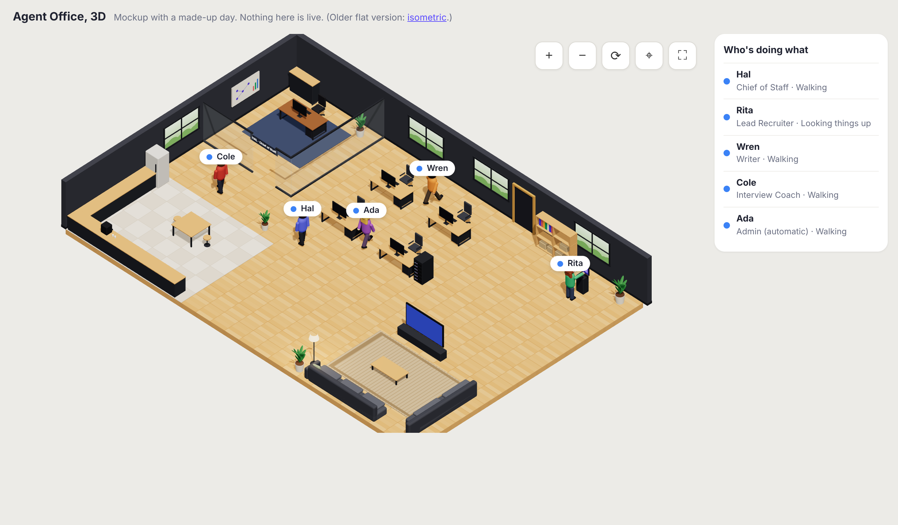
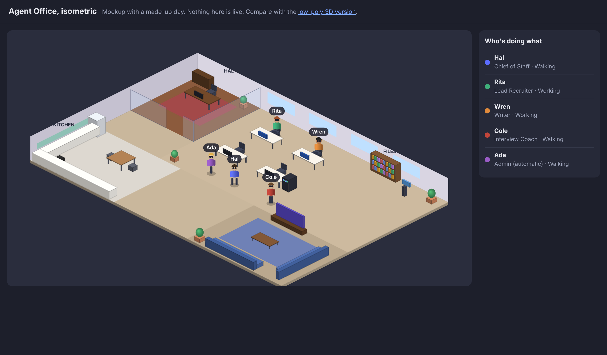
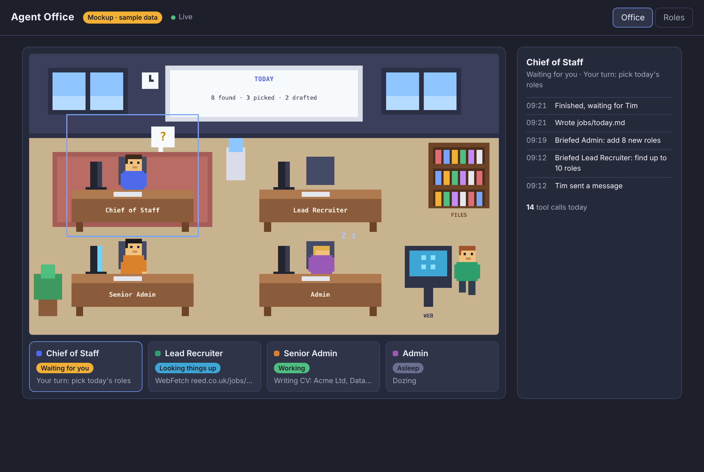
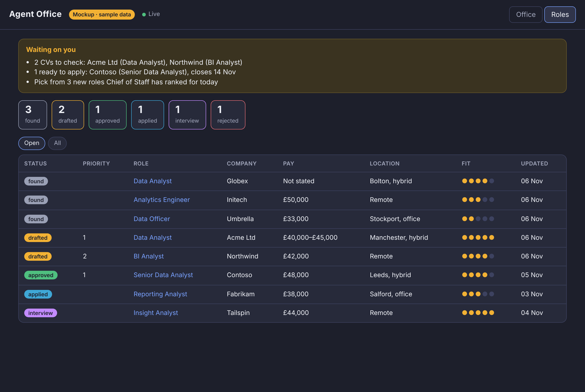

# Office view mockup

## New office (2026-11-06): pick a style

Two working mockups of the redesigned office, with the same floor plan and a made-up day:
- an open-plan floor with five desks
- Hal's glass-walled office
- a staff kitchen with a coffee machine and a table
- a lounge with sofas and a TV

Staff work at their desks, walk to the files shelf or the web kiosk, fetch coffee (and carry the mug back), sit on the sofas when idle, and nap there when asleep. A `!` above someone means they're waiting for you.

- `office-3d.html`: **3D with an isometric camera**, styled after the office Tim shared: dark walls, wooden floor tiles, swivel chairs, glowing monitors, a whiteboard, a server rack, a floor lamp, plants, and white name tags with a status dot. Buttons for zoom in and out, turning the room a quarter at a time, recentring and full screen. Drag to move around. Add `?speed=10` to the address to speed up the made-up day. Uses Three.js from the jsDelivr CDN, so it needs internet.
- `office-iso.html`: **isometric 2.5D** (plain canvas, works offline). A fixed angle.
- `office-sim.js`: the floor plan and the made-up day, shared by both.

Double-click either page to open it.

## The original pixel-art mockup

A mockup of the office and the Roles dashboard, with **sample data**. Nothing here is live.

- `index.html`: open it in any browser (double-click it). Click a character or a card to see its activity log, and switch between the **Office** and **Roles** tabs.
- `screenshot-office.png`, `screenshot-roles.png`: the same pages as pictures, for viewing on GitHub or a phone.

## What it shows

**Office tab**
- One desk per agent. Chief of Staff's desk sits on the rug.
- What each character is doing:
  - **Working:** at the desk, typing, screen on.
  - **Looking things up:** walked to the FILES shelf (reading files) or the WEB kiosk (searching the web).
  - **Waiting for you:** a bobbing `?` above the head.
  - **Asleep:** head down, `z Z`.
  - **Idle:** sitting still.
- The whiteboard shows today's numbers from the role tracker.
- Cards under the room give each agent's state in words. The panel on the right shows the selected agent's recent activity and how many tool calls it has made today.

**Roles tab**
- "Waiting on you": CVs to check, roles ready to apply for, and roles to pick from.
- Totals by status, then a table of roles (open roles only, or all). Each role links to its advert.

Tim: say what you'd like changed (layout, colours, what's shown) before the real version is wired up.
