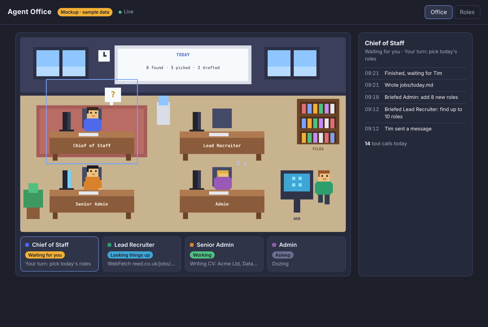

# Agent Office (office view)

Shows Tim's agents as pixel-art coworkers in an office, so he can see at a glance who is working, who is waiting for him and who has finished. A **Roles** tab shows the job-search tracker as a dashboard.



## Open the office

One-off, in this folder (`shared/office-view`), with Node.js 20 or newer installed:

```
npm install
```

Then, each time:

```
npm start
```

and open **http://127.0.0.1:4747** in your browser. Leave the terminal open while you use it; Ctrl+C closes the office.

Now use Claude Code in the `agent-office` folder as normal (for example `/cos start the day`). The characters move as the agents work.

**To see it working without using any tokens**, run this in a second terminal, in the same folder:

```
npm run fake
```

It acts out a job-search day on a loop. `npm run fake -- --fast` plays it three times faster.

## What you see

| On screen | Means |
|---|---|
| Typing at the desk, screen on | Working |
| At the FILES shelf | Reading or searching files |
| At the WEB kiosk | Searching or reading the web |
| Bobbing `?` | Waiting for you: Chief of Staff's "Your turn", or a permission prompt |
| Sitting still | Idle: finished, or waiting on a teammate |
| Head down, `z Z` | Asleep: not used for a while |

Click a character or its card to see what it has been doing. The whiteboard and the **Roles** tab read `jobs/tracker.json` and update within a few seconds of any change.

## How it works

- **Agents:** Claude Code hooks in `.claude/settings.json` run `hooks/report.mjs` on each event (session start, prompt, tool use, notification, stop, subagent stop, session end). It sends a few short fields to the bridge. If the office isn't open, it gives up within half a second and does nothing.
- **Bridge:** `src/server.ts` turns the reports into what each agent is doing (logic in `src/office.ts`), watches the tracker and pushes updates to the page. It only listens on this PC (127.0.0.1).
- **Page:** `public/` draws the office with PixiJS.

A session started in the `agent-office` folder is Chief of Staff. Subagents it calls (Lead Recruiter, Senior Admin, Admin) get their own characters. Sessions from other folders appear as visitors, but only if you also add the hooks to your user settings.

**Inputs:** Claude Code hook events; `jobs/tracker.json`.
**Outputs:** the web page. Nothing is written to disk. The office keeps no history once it is closed.

## Settings

- `OFFICE_PORT`: use a different port (default 4747). Set it for both the office and Claude Code.
- `OFFICE_TRACKER`: show a different tracker file (for testing).

## For developers

- `npm test`: tests for the state logic.
- `npm run check`: TypeScript type check.
- `mockup/`: the original mockup with sample data.
