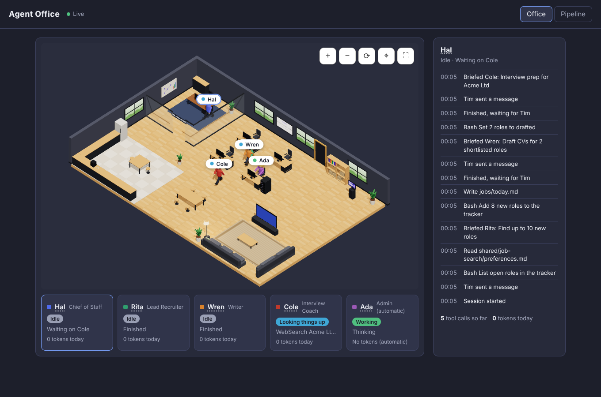

# Agent Office (office view)

Shows Tim's agents as coworkers in a 3D open-plan office (Hal's glass office, desks, a kitchen and a lounge), so he can see at a glance who is working, who is waiting for him and who has finished. A dashboard in the style of Tim's Job Hunt artifact (Overview, Roles, Leads, Interviews, Next actions, CVs) shows every role, with a page for each holding its CV, cover letter, attachments and interview talking points.



## Open the office

**On Windows, the easy way:** double-click **`Open Office.cmd`** in this folder. The first time, it installs what's needed (about a minute), then starts the office and opens it in your browser. Leave its window open while you use the office; closing the window closes the office. If the office is already open, it just shows it.

- **Desktop shortcut:** right-click `Open Office.cmd` → *Show more options* → *Send to* → *Desktop (create shortcut)*.
- **Open automatically when you log in:** press Win+R, type `shell:startup`, press Enter, and put a shortcut to `Open Office.cmd` in the folder that opens.
- You need [Node.js](https://nodejs.org) (the LTS version) installed.

**From a terminal**, one-off, in this folder (`shared/office-view`), with Node.js 20 or newer installed:

```
npm install
```

Then, each time:

```
npm start
```

and open **http://127.0.0.1:4747** in your browser. Leave the terminal open while you use it; Ctrl+C closes the office.

Now use Claude Code in the `agent-office` folder as normal (for example `/cos start the day`). The characters move as the agents work.

**To see it working without using any tokens**, run this in a second terminal, in the same folder:

```
npm run fake
```

It acts out a job-search day on a loop. `npm run fake -- --fast` plays it three times faster.

## What you see

| On screen | Means |
|---|---|
| Typing at the desk, screen lit | Working |
| At the bookshelf | Reading or searching files |
| At the web screen by the window | Searching or reading the web |
| Yellow name tag with `!` | Waiting for you: Hal's "Your turn", or a permission prompt |
| Getting a coffee, or on the sofas | Idle: finished, or waiting on a teammate. They wander between the kitchen, the sofas and their desk |
| Lying on a sofa, `Z z` | Asleep: not used for a while (Ada dozes at her desk) |
| Someone at the meeting table | A visiting helper: a subagent that isn't one of the team |

The dot on each name tag shows the same: green working, blue looking things up, amber waiting, grey idle or asleep.

**Moving around:** drag to move. The buttons zoom in and out, turn the room a quarter at a time (the walls nearest you hide), recentre and go full screen.

Click a person or their card to see what they've been doing. Click a **name** to see that person's (novelty) contract. The TODAY board on the back wall and the dashboard read `jobs/tracker.json` and update within a few seconds of any change.

## The dashboard

The dashboard follows Tim's Job Hunt artifact: dark, with a sidebar (collapse it with the arrow) and the same cards, charts and dialogs. On a phone the sidebar becomes a strip along the top. Press `/` to search.

| Sidebar | What it shows |
|---|---|
| **Overview** | Key numbers (active roles, applications sent, interviews, top of the pay range), the pipeline chart, applications per week, **Waiting on you**, upcoming interviews and next actions. A banner shows how many leads are waiting. The strip at the top shows Hal, the backup and today's tokens. |
| **Roles** | Every role from Shortlisted on, as a **board** (drag a card to change its stage) or a **list** (sort by priority, pay, fit, Hal's verdict, closing date or last update). Dropping a card on **Rejected** asks for an optional reason. |
| **Leads** | Roles found but not picked yet, best first, with Hal's verdict, fit and reason. Filter by verdict or list. **To pipeline** shortlists one (Wren starts writing); **✕** dismisses it; the sparkle opens **Tailor a CV**. Every move has an **Undo**. Dismissed leads can be restored. |
| **Interviews** | Upcoming interviews first; each opens Cole's prep and your talking points. |
| **Next actions** | Your to-do list: add, tick and untick. Hal adds questions here when he runs on his own. |
| **CVs** | Your CV bank (what Wren may use), your CV writing rules (editable), and every tailored CV and cover letter, with View, PDF and Word. |
| **The office** | The 3D office, the team's cards and the activity log. |

The **Target** card in the sidebar comes from `shared/job-search/preferences.md` (ask Hal to change it).

**Tailor a CV** (CVs page, or the sparkle on a lead or a tailored CV): pick the role, paste the job description or upload it (a .txt or .md is read straight in; a PDF or Word file is attached to the role for Wren to read), and say what to bring out. It goes to **Wren**, who writes the CV and cover letter from the CV bank; Ada fact-checks them. Tailoring a lead shortlists it. If the role already has documents, Wren redoes them. Your CV writing rules can be edited in the same dialog; Wren follows them every time.

**What each stage means:**

| Stage | What happens automatically |
|---|---|
| **Lead** | Ranked best first (P1, P2…: Hal's verdict, then fit, pay and closing date). Rita reads roles you add and Hal gives a verdict. |
| **Shortlisted** | Wren writes the tailored CV and cover letter; Ada checks the facts and builds the Word files; then the role moves to Drafted. |
| **Drafted** | The documents are ready for you to check. Approve, or ask Wren for changes. |
| **Approved** | Ada makes the PDFs, ready for you to apply. |
| **Applied** | Ada sets a follow-up date a week ahead. |
| **Interview** | Cole writes your prep and key talking points. |
| **Offer / Rejected / Dismissed** | Recorded with any reason, which feeds the preference reviews. Moving a role back to Leads (or Dismissed) cancels drafting nobody has started. |

Board cards show title, company, pay and location; fit dots and priority; the **closing date** (amber within a week); the **interview date**; **document ticks** (✓ CV, ✓ Letter, ✓ PDF, ✓ Prep, 📎 attachments); the next step (red ⚠ when a follow-up is overdue); "Hal is on it"; and Hal's verdict.

**Click any role** to open its page:
- **Overview:** Rita's summary of the advert, with your next step and notes, which you can edit there.
- **Documents:**
  - the CV and cover letter as documents, with **Download Word** and **PDF** buttons
  - Wren's notes on gaps
  - **attachments**: attach the exact CV you sent, or the advert saved as a PDF
  - **Ask Wren for changes**, in your own words
- **Interview:**
  - date and who it's with
  - your **key talking points**: edit, reorder, add or delete them, then save. Cole never overwrites them; his ideas appear as suggestions you can add with one click.
  - Cole's prep notes: the company, likely questions with answer plans, gaps, and questions to ask
  - **Refresh prep**
- **Activity:** who changed what and when, and what Hal was asked to do.

## Editing, backups and Hal

- **Edit details:** priority, next step, closing date, interview date and who it's with, reason and notes. Use **Edit details** on a role's page, or the reason dialog.

Your edits are **backed up to GitHub automatically**, about 15 seconds after you stop editing. The strip at the top of the tab shows "Saved to GitHub", or what went wrong.

**The team acts on your changes automatically:**

| You… | What happens | Tokens |
|---|---|---|
| set a role to **shortlisted** | Hal gets **Wren** (Writer) to draft a tailored CV and cover letter | yes |
| set a role to **drafted** before it has a CV | the same: **Wren** drafts the CV and cover letter | yes |
| set a role to **approved** | **Ada** (automation) makes the PDFs straight away. If there are no Word files yet, Hal gets Wren to draft them first | none, if the Word files exist |
| set a role to **applied** | **Ada** sets the next step to "Follow up if no reply by …" (7 days later) | none |
| set a role to **interview** | Hal gets **Cole** (Interview Coach) to write key talking points and prep notes | yes |
| **add a role** (with a link, or the advert text pasted in) | Hal gets **Rita** (Lead Recruiter) to read the advert, score the fit and give a verdict: worth applying or not | yes |
| add or change a role's **advert link**, or paste its advert text, in **Edit details** | Rita reads the advert and writes the listing, and Hal gives a fresh verdict. If the role is waiting for Wren, she drafts once the listing is there | yes |
| press **Ask Hal: worth applying?** on a role's Overview | Rita gives a verdict from the role's listing (no web searching, so it's cheap) | yes |
| **Ask Wren for changes** on a role page | Hal gets **Wren** to revise the CV and letter, in your words | yes |
| **Refresh prep** on a role page | Hal gets **Cole** to refresh the prep notes (your talking points are kept) | yes |
| attach a file, or edit talking points or notes | saved and backed up | none |

Hal starts **2 minutes after your last change**, so several changes share one run. He runs on Sonnet to save tokens, and at most **8 times a day**. Other changes (notes, next steps, applied, skipped) don't start him. The strip shows when he'll start, with **Run now** and an **Auto start** on/off switch. Anything he needs to ask you appears under "Waiting on you". Each run's log is saved in `logs/`.

Needs, on this PC:
- **Python 3**, for editing.
- **Claude Code**, signed in, for Hal's automatic runs. Without it, run `/cos` yourself.

Automatic runs can only use the job-search tools: reading and writing files, the tracker, git, documents and the web.

They also can't rewrite or throw away git history (force-push, hard reset, deleting branches, `git clean` and the like). `hooks/guard.mjs` refuses those commands whenever the office started the run, because CLAUDE.md only allows them when Tim asks, and he isn't watching. Hal is told to add an action for Tim instead. In sessions Tim starts himself, the guard does nothing.

## How it works

- **Agents:** Claude Code hooks in `.claude/settings.json` run `hooks/report.mjs` on each event (session start, prompt, tool use, notification, stop, subagent stop, session end). It sends a few short fields to the bridge. If the office isn't open, it gives up within half a second and does nothing.
- **Bridge:** `src/server.ts` turns the reports into what each agent is doing (logic in `src/office.ts`), watches the tracker and pushes updates to the page. It only listens on this PC (127.0.0.1).
- **Page:** `public/scene.js` draws the office in 3D with Three.js (pinned in `package.json`, served from `/vendor`), using the floor plan in `public/floorplan.js`. `public/office.js` holds the cards, log and contracts.

A session started in the `agent-office` folder is Hal. The subagents he calls (Rita, Wren, Cole) get their own desks, and Ada's desk shows the office's automatic work.

**Token meter:** each card shows that person's **fresh tokens today** (new input + output), from Claude Code's own transcripts. Re-reads of the same context are much cheaper and shown separately in the side panel. The TODAY board and the Overview strip show the day's total. Ada always shows "No tokens". Sessions from other folders appear as visitors, but only if you also add the hooks to your user settings.

**Inputs:** Claude Code hook events; `jobs/tracker.json`.
**Outputs:** the web page. Nothing is written to disk. The office keeps no history once it is closed.

## Problems

- **"running scripts is disabled on this system"** (PowerShell): use `npm.cmd` instead of `npm`, or run `Set-ExecutionPolicy -Scope CurrentUser RemoteSigned` once. `Open Office.cmd` avoids this.
- **"Could not read package.json"**: the terminal isn't in this folder. `cd` into `shared\office-view` first, or use `Open Office.cmd`.
- **"Port 4747 is already in use"**: the office is already open somewhere; go to http://127.0.0.1:4747.

## Settings

- `OFFICE_PORT`: use a different port (default 4747). Set it for both the office and Claude Code.
- `OFFICE_TRACKER`: show a different tracker file (for testing).
- `OFFICE_COS_MAX_PER_DAY`: Hal's daily limit of automatic runs (default 8).
- `OFFICE_DAILY_TOKEN_BUDGET`: optional daily budget of fresh tokens, e.g. `200000`. When it's used up, Hal stops starting by himself until tomorrow (you can still run `/hal`).
- `OFFICE_PYTHON`, `OFFICE_CLAUDE`: the commands for Python and Claude Code, if the office can't find them.

## For developers

- `npm test`: tests for the state logic.
- `npm run check`: TypeScript type check.
- `mockup/`: the original mockup with sample data.
